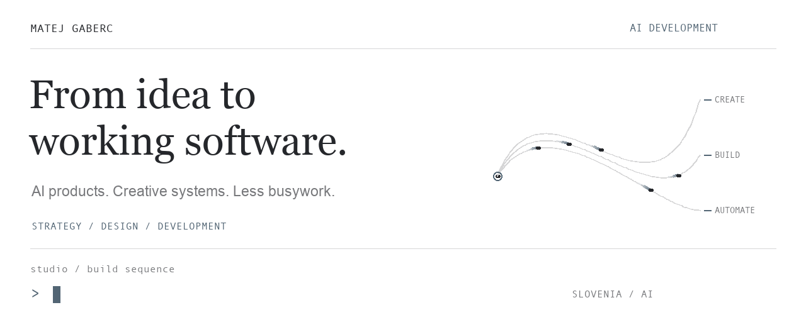

<picture>
  <source media="(prefers-color-scheme: dark) and (prefers-reduced-motion: reduce)" srcset="hero-dark.png">
  <source media="(prefers-color-scheme: light) and (prefers-reduced-motion: reduce)" srcset="hero-light.png">
  <source media="(prefers-color-scheme: dark)" srcset="hero-dark.gif">
  <source media="(prefers-color-scheme: light)" srcset="hero-light.gif">
  
</picture>

I'm Matej Gaberc, an AI developer based in Slovenia. I turn business ideas into useful software, combining development, design and creative production.

I work end to end: understanding the problem, designing the experience, building the solution and connecting it to your existing tools.

### What I do

<table>
<tr>
<td width="50%"><strong>Websites &amp; apps</strong> From landing pages to custom digital products.</td>
<td width="50%"><strong>AI agents &amp; bots</strong> Assistants that work with your business knowledge.</td>
</tr>
<tr>
<td><strong>Automation &amp; sales</strong> Connected workflows, lead research and CRM systems.</td>
<td><strong>Marketing &amp; ad creatives</strong> AI-assisted content and visuals for your brand.</td>
</tr>
</table>

**Built with:** TypeScript · React / Next.js · Supabase · Claude & OpenAI APIs

Have something in mind? [Let’s talk →](mailto:matej.gaberc2004@gmail.com)
