<picture>
  <source media="(prefers-color-scheme: dark)" srcset="hero-dark.svg">
  <source media="(prefers-color-scheme: light)" srcset="hero-light.svg">
  
</picture>

I'm Matej, a Multimedia student at the University of Ljubljana and a software developer. I work where **computer-vision research** meets **AI systems that run in production**: I like problems where a model has to be measured honestly before anyone relies on it.

### Research

**[Occlusion-aware signature verification](https://github.com/gabercmatej/Occlusion-aware-signature-verification)** · *bachelor's thesis, in progress*
Document stamps hide parts of handwritten signatures, and removing them can erase or invent the very strokes that identify a writer. I'm building a verification pipeline that removes stamps without redrawing anything, records every changed pixel, and asks whether a comparison that knows what was changed rejects forgeries more reliably.
`Python` `OpenCV` `NumPy` · controlled experiments on unseen writers and stamps

### Production AI

<table>
<tr>
<td width="33%" valign="top"><b><a href="https://github.com/gabercmatej/Meta-message-answering-bot">AI messaging platform</a></b> End-to-end system that answers Facebook and Instagram messages for a legal-services brand: classification, knowledge-grounded drafting, safety validation, automatic publishing and an operator console. In production.</td>
<td width="33%" valign="top"><b><a href="https://github.com/gabercmatej/Meta-Google-ads-sales-analytics-platform">Ads &amp; sales analytics</a></b> Meta Ads, Google Ads and sales data in one place, with an AI assistant that answers only from verified figures and campaign changes that need human approval.</td>
<td width="33%" valign="top"><b><a href="https://github.com/gabercmatej/Pitch-presentation-AI-assistant">AI presentation assistant</a></b> Real-time voice assistant for client meetings: answers spoken questions about the deck, takes meeting notes and navigates slides by voice.</td>
</tr>
</table>

### Computer vision

- **[Computer Vision in Python](https://github.com/gabercmatej/Machine-perception-course)**: six classical vision studies, from filtering and retrieval to RANSAC, stereo reconstruction and eigenfaces, with an [interactive showcase](https://gabercmatej.github.io/Machine-perception-course/).
- **[CueCam](https://github.com/gabercmatej/cuecam)**: real-time gesture and voice recognition that turns a webcam into a live effects engine for video calls.

**Toolbox:** Python · TypeScript · NumPy · OpenCV · MediaPipe · Node.js · React · PostgreSQL · LLM APIs

Open to research and engineering internships in computer vision and machine learning in 2027 · [LinkedIn](https://www.linkedin.com/in/matej-gaberc-49a466422/) · [Email](mailto:matej.gaberc2004@gmail.com)
